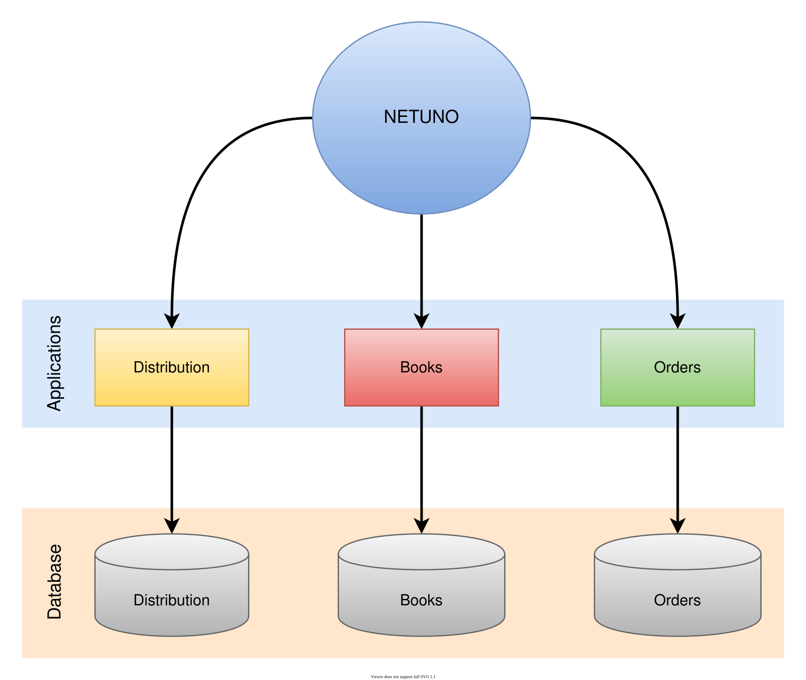
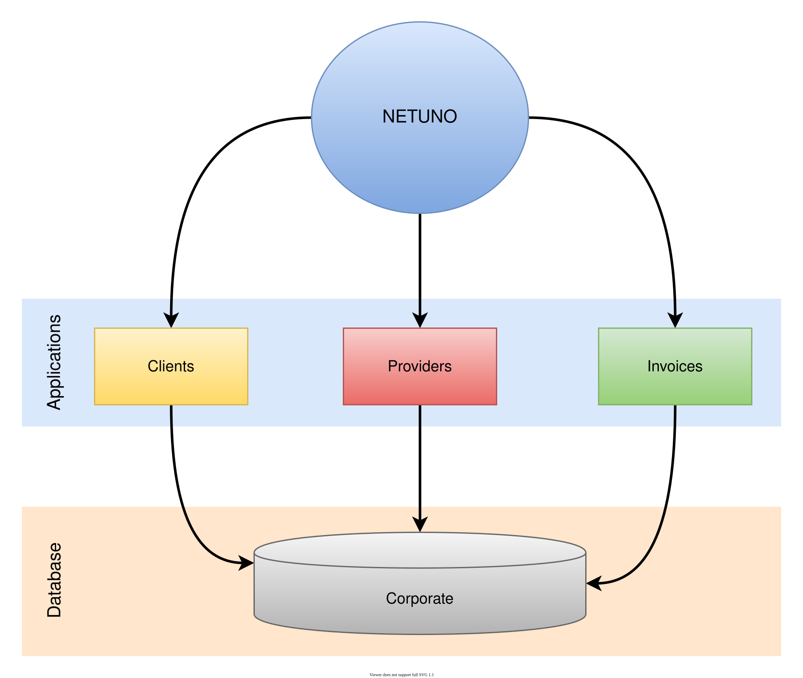

Netuno is a multi-application server that distributes access to applications through domains and subdomains.

Multiple web applications can be either public or private, as Netuno handles back-office construction. Therefore, applications typically have private access, but a public interface is optional.

When developing multiple applications on Netuno, they can be either decoupled or coupled at the database level.

This means that we can share the same database across multiple applications or have separate databases for each application.

## Application Folder

Applications are located within the `apps` folder in the Netuno root directory.

This is where all the applications that Netuno can use are found.

When creating a new application with the command:

`./netuno app`

A folder with the application's name is created inside the `apps` folder to contain the entire application structure.

When it's necessary to use an existing application, such as one available on GIT, it must be cloned
inside the `apps` folder.

## External Applications

Netuno allows applications to be outside the `apps` folder.

To configure an external application, a file called `application-name.json` must be created inside the `apps` folder.

This JSON file must contain an object with the key `home` and the path to the folder where the external application is located.

> It can be an absolute path, a relative path; normally any way of defining the path works, as long as the
> path is correct.

Example with the full path:

```json title="apps/my_app.json"
{
    "home": "/home/user/projects/my_app"
}
```

Example with the relative path from the `apps` folder:

```json title="apps/cluar.json"
{
    "home": "../../../Development/cluar"
}
```

Example with a special shortcut in the path, relative to the user's root folder:

```json title="apps/my_app.json"
{
    "home": "~/Projects/MyApp"
}
```

In the JSON file, it is possible to override any application configuration; add the application configuration you want to change to the JSON object.

## Application Address

Netuno automatically distributes access to applications through the domain and subdomain. When a request arrives at Netuno, the domain is processed as follows:

- `http://`**my-app-subdomain**`.my-domain.org/`

Netuno searches up to the first dot to see if an application with this name exists.

> The character `-` (hyphen) in the subdomain is automatically replaced by `_` (underscore) for the application name.
>
> Because the `-` (hyphen) is not a valid character in the application name and the `_` (underscore) is not a valid character in the domain.
>
> This adaptation is therefore done automatically internally in Netuno.

If an application with this name exists, then this will be the application to receive the request.

If no application with this name exists, then the request will be delivered to the default application.

This domain resolution also works when it's a sub-subdomain, for example:

- `http://`**my-app-sub-subdomain**`.subdomain.my-domain.org/`

That is, up to the first point, you define which application will receive the request to be processed.

Netuno also allows you to define an exact address with a domain for the application; you just need to define the exact address where the application will work.

With the `host` and `url` configuration in the applications, it's possible to customize the addresses. See more about this at:

- [Customize URLs](/docs/academy/server/custom-urls)

> Using the automatic method to process domains allows applications to function in the vast majority of cases. However, if there are situations that require a completely different and specific address for the application to function, then it is necessary to define it in its configuration.

## Decoupled Applications Across Multiple Databases

When dealing with applications with completely different scopes, it doesn't make sense for them to share the same database.

Imagine you have one application for sending newsletters, another for managing books, and another for managing deliveries. None of them needs information stored in another application; they are completely independent.

Therefore, there's no reason for them to share the same database; instead, each should have its own database:



This way, no application knows the information stored in the other applications, and its entire operation is independent of the other existing applications.

## Applications Coupled to the Same Database

When working with applications that need to share information and may involve a large volume of data, sharing the database is the most viable solution in terms of performance, but it is not the best solution in terms of data security and integrity.

Therefore, for security and integrity reasons, large web applications are usually created where everything is centralized in a complex application that uses its own exclusive database. If the application needs external data, it can integrate with other databases and web services if necessary.

In this case, Netuno already provides all the means for developing this type of application, but it also offers a good solution for applications with a shared database.

Since the main problem is data security and integrity, with Netuno, when several applications use the same database, they are automatically limited to their tables that are related to their forms.

It allows sharing the form and consequently its table with other applications that are coupled to the database.

Imagine a scenario where you have one application for customer management, another for supplier management, and another for invoicing. This is because you will have invoices from suppliers to be paid and invoices from customers to be received.

The customer application should not share data with the supplier application; they are distinct applications.

However, the invoicing application needs to integrate with both applications to obtain data from the customer and supplier applications in order to link invoices and manage collections and payments in various situations.



To ensure that the applications do not interfere with each other's sensitive data, it is also recommended to use separate database access for each application, and you can also control their access to tables via the database to ensure that there is no unwanted interference.

Furthermore, Netuno handles the control to separate what belongs to one application from another, and also what is shared between them.
