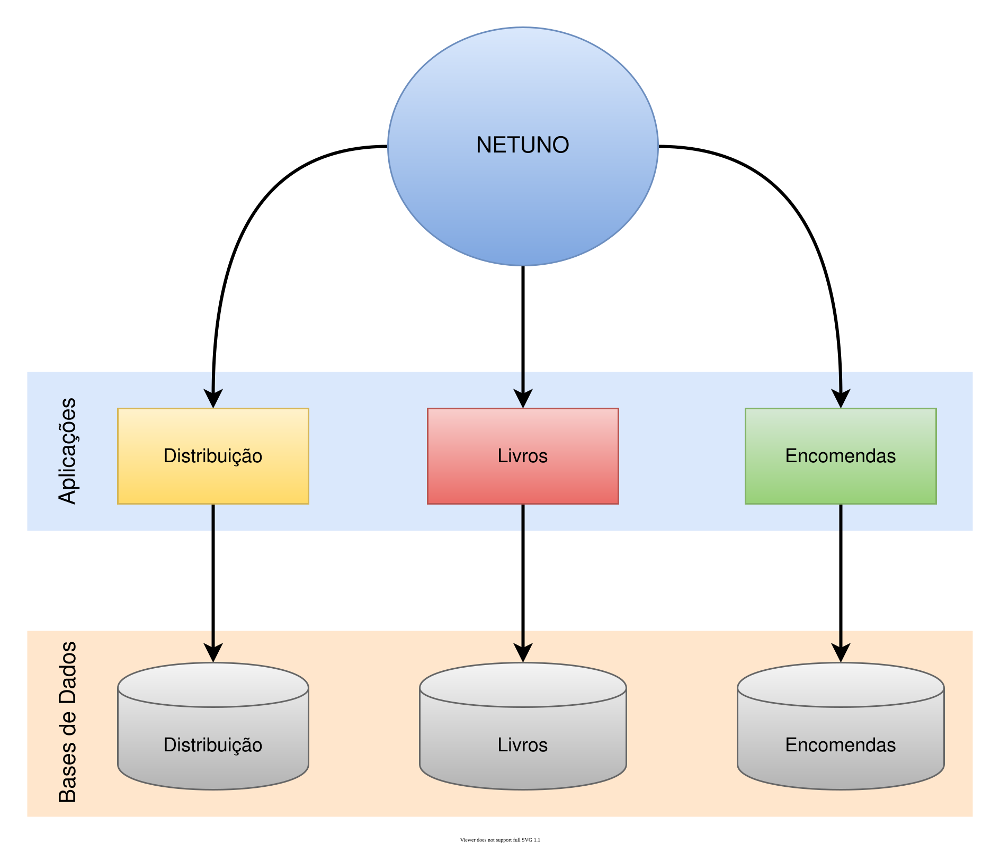
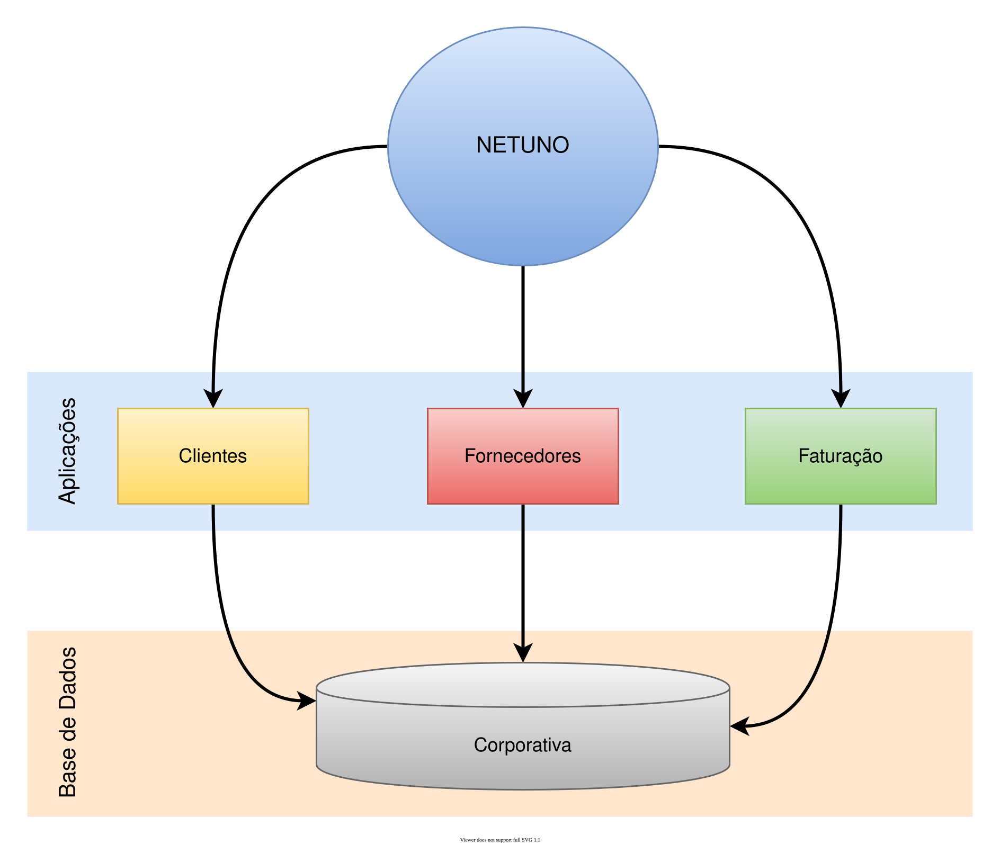

O Netuno é um servidor de múltiplas aplicações e que distribui o acesso às aplicações através de domínios e subdomínios.

Múltiplas aplicações web que podem ser tanto públicas como privadas, como o Netuno realiza a construção de backoffices. Então por norma as aplicações têm sempre um acesso privado, mas a interface pública é opcional.

Ao desenvolver múltiplas aplicações no Netuno tanto podem ser desacopladas ou mesmo acopladas ao nível de base de dados.

Isto quer dizer que podemos partilhar a mesma base de dados por múltiplas aplicações ou ter as bases de dados separadas para cada aplicação.

## Pasta das Aplicações

As aplicações ficam dentro da pasta `apps` na raíz do Netuno.

É onde todas as aplicações que o Netuno pode utilizar encontram-se.

Quando criamos uma nova aplicação com o comando:

- `./netuno app`

Uma pasta com o nome da aplicação é criada dentro da pasta `apps` para conter toda a estrutura da aplicação.

Quando é necessário utilizar uma aplicação já existente, como uma aplicação disponível no GIT, deve-se clonar
dentro da pasta `apps`.

## Aplicações Externas

O Netuno permite ter aplicações fora da pasta `apps`.

Para configurar uma aplicação externa deve-se criar o arquivo `nome-aplicacao.json` dentro da pasta `apps`.

Neste arquivo JSON deve conter um objeto com a chave `home` e com o caminho da pasta onde a aplicação externa 
encontra-se.

> Tanto pode ser caminho absoluto, relativo, normalmente qualquer forma de definir o caminho funciona, des que o
> caminho esteja correto.

Exemplo com o caminho completo:

```json title="apps/my_app.json"
{
  "home": "/home/user/projects/my_app"
}
```

Exemplo com o caminho relativo a partir da pasta `apps`:

```json title="apps/cluar.json"
{
  "home": "../../../Desenvolvimento/cluar"
}
```

Exemplo com atalho especial no caminho, relativo à pasta raíz do usuário:

```json title="apps/minha_app.json"
{
  "home": "~/Projetos/MinhaApp"
}
```

No arquivo JSON é possível sobrescrever qualquer configuração da aplicação, adicione no objeto JSON a 
configuração da aplicação que deseja alterar.

## Endereço da Aplicação

O Netuno de forma automática realiza a distribuição do acesso às aplicações através do domínio e subdomínio.

Quando chega um pedido no Netuno, o domínio é processado da seguinte forma:

- `http://`**minha-app-subdominio**`.meu-dominio.org/`

O Netuno procura até ao primeiro ponto se existe uma aplicação com este nome.

> Sendo que o carácter `-` (traço) no subdomínio é automaticamente substituído por `_` (subtraço) para o nome da aplicação.
> 
> Porque o `-` (traço) não é um carácter válido no nome da aplicação e o `_` (subtraço) não é um carácter válido no domínio.
> 
> Esta adaptação, portanto é feita automaticamente internamente no Netuno.

Se existir uma aplicação com este nome então será esta a aplicação a receber o pedido.

Caso não exista nenhuma aplicação com este nome então o pedido será entregue para a aplicação padrão (_default_).

Esta resolução de domínios também funciona quando é um sub-subdomínio, por exemplo:

- `http://`**minha-app-sub-subdominio**`.subdominio.meu-dominio.org/`

Ou seja, até ao primeiro ponto é defina qual será a aplicação que receberá o pedido para ser processado.

E o Netuno também permite definir um endereço exato com domínio para a aplicação, basta definir qual será o endereço exato na qual a aplicação funcionará.

Com a configuração de `host` e de `url` nas aplicações é possível customizar os endereços, veja mais sobre em:

- [Customizar URLs](/docs/academy/server/custom-urls)

> Utilizando a forma automática para processar domínios permite o funcionamento das aplicações na grande maioria dos casos, caso mesmo assim haja situações que necessite do endereço completamente diferente e específico para o funcionamento da aplicação então é necesário defini-lo na sua configuração.

## Aplicações Desacopladas em múltiplas Bases de Dados

Quando trata-se de aplicações com âmbitos completamente distintos então não fará sentido partilharem a mesma base de dados.

Imagine que tem uma aplicação para o envio de Newsletter, outra para gerir Livros e outra para gerir as Entregas, sendo que nenhuma necessita de informação armazenada em outra aplicação, estas são completamente independentes.

Assim, não há razão para partilharem a mesma base de dados e sim cada uma ter a sua própria base de dados:



Desta forma nenhuma aplicação conhece a informação armazenada nas outras aplicações e todo o seu funcionamento é independente das outras aplicações existentes.

## Aplicações Acopladas na mesma Base de Dados

Quando trabalhamos com aplicações que precisam partilhar informações e que pode haver grande volume de dados, a partilha da base de dados é a solução mais viável a nível de performance, mas não é a melhor solução a nível de segurança e integridade dos dados.

Assim, por questões de segurança e integridade, normalmente são criadas grandes aplicações web onde tudo está centralizado numa aplicação complexa e que utiliza a sua base de dados exclusiva, caso a aplicação precise de dados externos então pode integrar com outras bases de dados e web services se for necessário.

Neste caso, o Netuno já fornece todos os meios para o desenvolvimento deste tipo de aplicações, mas também oferece uma boa solução para aplicações com base de dados partilhada.

Sendo o principal problema a segurança e integridade dos dados, com o Netuno quando várias aplicações utilizam a mesma base de dados estas automaticamente ficam limitadas às suas tabelas que estão relacionadas com os seus formulários.

Permite partilhar o formulário e consequentemente a sua tabela pelas outras aplicações que estão acopladas na base de dados.

Imagine o cenário em que tem uma aplicação para a gestão de clientes, outra para a gestão de fornecedores e outra para a faturação, isto por que tanto terá faturas de fornecedores para serem pagas como de clientes para receber.

A aplicação de cliente não deve partilhar dados com a aplicação de fornecedores, são aplicações distintas.

Mas a aplicação de faturação precisa integrar com ambas as aplicações para obter os dados da aplicação de clientes e de fornecedores para poder relacionar as faturas e gerir cobranças e pagamentos nas diveras situações.



Para garantir que as aplicações não interferem em dados sensíveis uma das outras recomenda-se também a utilização do acessos à base de dados distintos para cada aplicação, e pode-se ainda controlar via base de dados os seus acesso às tabelas para garantir que não haja interferência indesejada.

De resto o Netuno realiza o controlo para separar o que é de uma aplicação ou de outra e ainda o que é partilhado entre elas.
